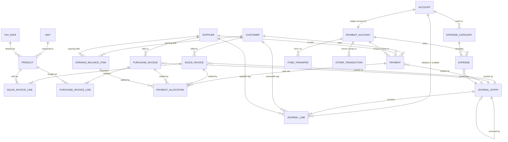

# TEXTILE ACCOUNTS MANAGEMENT SYSTEM — IMPLEMENTATION PLAN (v2)

Business: small textile manufacturer in Tamil Nadu, India. Buys yarn, weaves fabric, sells fabric.
Users: owner only at first. Real business use (not a demo). Developer: beginner. Owner: non-technical.

---

## 0. HOW YOU (THE AI AGENT) MUST WORK

1. Explain everything in simple language. Explain each accounting term the first time you use it.
2. Work ONE PHASE at a time (see section 12). At the start of a phase: restate its goal and completion criteria, list the files you will create or change, then WAIT for me to say "approved". At the end: run all tests, show a results summary, and show the completion-criteria checklist with evidence. Do NOT start the next phase until I say so.
3. This document is the design. Do not silently redesign it. If you find a bug, contradiction, or better option: stop, explain in 10 lines or fewer, recommend one option, and wait.
4. YOUR FIRST REPLY: (a) confirm your understanding in 10 lines or fewer, (b) list any contradictions or risks you see in this plan (max 10), (c) nothing else. Do not write code. Wait for "start Phase 1". Phases 1-4 do not depend on the owner's answers in section 14.
5. Hard engineering rules:
   - Money is NUMERIC in the database and BigDecimal in Java. Never float or double. In JSON, money and quantities are strings.
   - Flyway: never edit an applied migration; add a new V file. Set `spring.jpa.hibernate.ddl-auto=validate` and `spring.jpa.open-in-view=false`.
   - Layering: controller -> service -> repository. DTOs are Java records, separate from JPA entities. No business logic in controllers. `@Transactional` only on service methods.
   - Only the `ledger` module may write `journal_entry` / `journal_line` (enforce with an ArchUnit test).
   - Time comes from an injected `Clock`, zone `Asia/Kolkata`. Business dates are `LocalDate`.
   - No secrets in code, logs, frontend, or git. `.env` is git-ignored; `.env.example` is committed.
   - Every endpoint needs authorization, validation, and tests.
   - No new dependency or paid service without asking me.
   - If a business rule is unknown: ask, or record it as an assumption in section 1. Never invent it.
   - Small commits, one per task.

---

## 1. SCOPE AND STATUS OF REQUIREMENTS

**Confirmed (from the owner brief):** web app for the owner only; no public registration; works on desktop and mobile browsers; invoices (sales and purchase), expenses, customers, suppliers, payments, cash and bank, reports, double-entry ledger, audit history, backups; modular monolith; Spring Boot, React, PostgreSQL; first version prioritizes accounting and invoicing; inventory and production come later.

**Assumptions (NOT confirmed; each must be confirmed in Phase 0 or the default is used):**

| # | Assumption | Default used |
|---|---|---|
| A1 | One business, one currency | INR |
| A2 | GST-registered regular taxpayer (not composition scheme) | Yes, tax is configurable per invoice line |
| A3 | Financial year | 1 April - 31 March, labelled like `2026-27` |
| A4 | Prices are tax-exclusive | Yes |
| A5 | Invoice total rounded to nearest rupee, with a visible round-off line | Yes (setting) |
| A6 | Place of supply defaults to the customer's state | Same state as business -> CGST+SGST; different -> IGST |
| A7 | Invoice number format | `INV/26-27/0001` (14 chars) |
| A8 | Payments are allocated bill-by-bill; unallocated money is kept as an advance | Yes |
| A9 | The business sells its own woven fabric (not job-work for others) | Yes; confirm |
| A10 | No credit notes or partial returns in Release 1; a wrong invoice is fully reversed and re-issued | Yes |
| A11 | Expenses are recorded when paid (no unpaid expense bills) | Yes |
| A12 | Wages are an expense when paid | Yes |
| A13 | UI language | English only |
| A14 | Hosting | Single VPS, Docker Compose (see section 11) |

---

## 2. ARCHITECTURE AND KEY DECISIONS

```text
Browser (desktop/mobile)
   |  HTTPS, one origin: https://app.example.com
   v
Caddy (reverse proxy, auto-HTTPS)
   |-- /            -> React static build
   |-- /api/*       -> Spring Boot (port 8080, internal only)
                        |-> PostgreSQL (internal network only, never exposed publicly)
```

| Topic | Decision | Why |
|---|---|---|
| Style | Modular monolith: one Spring Boot app, one React app, one PostgreSQL | Simplest correct design for one business |
| Same origin | React and API are served from the same domain through the reverse proxy | Avoids CORS and cross-site cookie/SameSite problems. Do NOT host frontend and backend on unrelated domains |
| Source of truth | Double-entry journal. Balances are never stored; they are computed from `journal_line` | Cannot drift out of sync |
| Owner experience | Owner never types debits or credits. Invoices, payments and expenses post balanced entries automatically in ONE database transaction | Matches the "simple for a non-technical owner" goal |
| Lifecycle | DRAFT -> POSTED -> REVERSED. Posted records are never edited or deleted | Audit safety |
| Corrections | Reversal + new entry. Drafts can be edited or deleted | Standard accounting practice |
| Calculations | Done only on the server. The UI asks `POST .../calculate` for live totals | One source of truth, no JS rounding bugs |
| Idempotency | Create/post/payment requests carry an `Idempotency-Key` UUID; replays return the original result | Stops double-click duplicates |
| Tests | Real PostgreSQL via Testcontainers, never H2 | Triggers, partial indexes and numeric behaviour differ in H2 |
| Inventory | Out of Release 1; chart of accounts already contains inventory/COGS accounts | Allows later addition without redesign |

**Backend:** Java (current LTS supported by the Spring Boot version chosen; verify at start), Spring Boot (latest stable at start; pin versions), Spring Web, Security, Data JPA, Validation, Actuator, Flyway (`flyway-core` + `flyway-database-postgresql`), PostgreSQL driver, spring-session-jdbc (so deploys do not log the owner out), springdoc-openapi (dev profile only), Thymeleaf + OpenHTMLtoPDF (PDF), Apache POI (Excel), Testcontainers, ArchUnit, JUnit 5, AssertJ. No Lombok, no MapStruct (manual mappers are easier to learn).
**Frontend:** Vite, React, TypeScript (strict), React Router, TanStack Query, React Hook Form + Zod, Mantine (use ONE component library only), dayjs, Vitest + React Testing Library, Playwright + axe. If Tamil screens are required (section 14), add react-i18next in Phase 3.
**Tools:** Git/GitHub (+ GitHub Actions CI, Dependabot, secret scanning), Maven, Docker Compose, Postman or the OpenAPI UI.

---

## 3. REPOSITORY STRUCTURE

```text
textile-accounts/
├── backend/
│   ├── pom.xml
│   └── src/
│       ├── main/java/<base>/
│       │   ├── common/        (errors, money utils, clock, idempotency, pagination)
│       │   ├── auth/          (user, login, lockout, security config)
│       │   ├── settings/      (business profile, lock date, financial years, number sequences)
│       │   ├── masterdata/    (customers, suppliers, products, units, tax rates, states)
│       │   ├── ledger/        (accounts, journal, PostingService, opening balances, integrity checks)
│       │   ├── sales/         (sales invoices, calculation)
│       │   ├── purchases/     (purchase invoices, calculation)
│       │   ├── payments/      (receipts, supplier payments, allocations)
│       │   ├── banking/       (payment accounts, transfers, other transactions, cash/bank books)
│       │   ├── expenses/
│       │   ├── reports/       (read-only queries, PDF/Excel export)
│       │   ├── dashboard/
│       │   └── audit/
│       ├── main/resources/ (db/migration/V1__*.sql ..., templates/ for PDFs, application*.yml)
│       └── test/           (java tests, resources/golden/*.json)
├── frontend/
│   └── src/ (api/, app/ (router, layout), components/, features/<module>/, utils/ (money, dates), i18n/ if needed)
├── deploy/ (docker-compose.yml, docker-compose.dev.yml, Caddyfile, backup.sh, restore.sh, README-runbook.md)
├── docs/ (accounting-conventions.md, owner-questions.md, test-plan.md, adr/)
├── .github/workflows/ci.yml
├── .env.example
├── .gitignore
└── README.md
```

Module rule: modules talk through service interfaces, never through each other's repositories. Only `ledger` writes journal tables.

---

## 4. ACCOUNTING DESIGN

### 4.1 Conventions (document these in docs/accounting-conventions.md)
- Every journal entry has 2 or more lines. Total debits = total credits, always.
- Assets and expenses increase with a debit. Liabilities, equity and income increase with a credit.
- Account balance: assets and expenses = debits - credits. Liabilities, equity and income = credits - debits.
- Customer ledger: Debit = we billed them. Credit = they paid us. Positive balance (Dr) = customer owes us. Negative (Cr) = customer advance.
- Supplier ledger: Credit = supplier billed us. Debit = we paid them. Positive balance (Cr) = we owe the supplier. Negative (Dr) = advance paid to the supplier.
- Customer and supplier balances are tracked by tagging lines on the single control account (Accounts Receivable / Accounts Payable) with `customer_id` / `supplier_id`. Sum of all customer balances MUST equal the Accounts Receivable account balance (same for payables).
- Code finds accounts by `system_role` (for example `AR_CONTROL`), never by hard-coded id or code.

### 4.2 Seed chart of accounts (Antigravity finalizes codes; CA reviews in Phase 0)
- Assets: Cash in Hand and Bank accounts (one ledger account per payment account, created automatically); Accounts Receivable [AR_CONTROL]; GST Input CGST / SGST / IGST (tax credit receivable); Inventory - Yarn, Work in Progress, Finished Fabric (unused until inventory exists); Fixed Assets (Machinery etc.).
- Liabilities: Accounts Payable [AP_CONTROL]; GST Output CGST / SGST / IGST; Loans.
- Equity: Owner's Capital; Owner's Drawings; Opening Balance Equity [OPENING_EQUITY] (balancing account for opening balances; CA reclassifies later).
- Income: Sales - Fabric [SALES].
- Cost of materials (`report_group = MATERIALS`): Purchases - Yarn [PURCHASES_YARN]; Purchases - Other Materials [PURCHASES_OTHER].
- Direct costs (`DIRECT`): Wages - Weaving; Freight Inward.
- Operating expenses (`OPERATING`): Electricity; Transport; Machine Maintenance; Rent; Repairs; Administrative; Interest and Bank Charges; Other Expenses.
- Round Off [ROUND_OFF] (expense account; debit balance = net rounding loss).

### 4.3 Posting recipes (the only way entries are created)

| Event | Debit | Credit |
|---|---|---|
| Sales invoice posted (same state) | Accounts Receivable (customer) = grand total; Round Off if total rounded down | Sales = taxable total; GST Output CGST; GST Output SGST; Round Off if total rounded up |
| Sales invoice posted (other state) | same | Sales; GST Output IGST |
| Purchase invoice posted | Purchases-Yarn or Purchases-Other (by product type) = taxable; GST Input CGST+SGST or IGST; Round Off if rounded up | Accounts Payable (supplier) = grand total; Round Off if rounded down |
| Receipt from customer | Cash or Bank | Accounts Receivable (customer) |
| Payment to supplier | Accounts Payable (supplier) | Cash or Bank |
| Expense | Expense account of the category | Cash or Bank |
| Fund transfer | Destination Cash/Bank | Source Cash/Bank |
| Owner capital introduced | Cash/Bank | Owner's Capital |
| Owner drawings | Owner's Drawings | Cash/Bank |
| Loan received / loan principal repaid | Cash/Bank / Loan | Loan / Cash/Bank (loan interest is a normal expense) |
| Asset purchase | Fixed Asset | Cash/Bank |
| Opening balance, customer item | Accounts Receivable (customer) | Opening Balance Equity |
| Opening balance, supplier item | Opening Balance Equity | Accounts Payable (supplier) |
| Opening balance, cash/bank/other accounts | each asset account with debit balance | each liability account with credit balance; Opening Balance Equity takes the difference |
| ANY reversal | the original credit lines | the original debit lines (exact mirror, same party tags) |

Transfers, owner capital/drawings, loans, and asset purchases never touch income or expense accounts.

### 4.4 Document lifecycle

| Status | Editable | Has journal entry | Has final number | Counted in reports/balances |
|---|---|---|---|---|
| DRAFT (sales, purchase invoices only) | Yes; can be deleted (audited) | No | No (shows "DRAFT") | No |
| POSTED | No | Yes | Yes | Yes |
| REVERSED | No | Yes + reversing entry | Number stays used, shown as "Cancelled" | Net effect zero; still visible in registers |

- Payments, expenses, transfers and other transactions are posted immediately (no draft).
- Correcting an invoice: "Reverse and copy to new draft". The new invoice gets a new number when posted.
- Correcting a payment, expense, transfer or other transaction: "Correct" button = reverse the old one and post the new one in one transaction; the new row stores `corrected_from_id`.
- A reversal posts on a chosen date (default today; not earlier than the original date; not on or before the lock date).
- An invoice that has active payment allocations cannot be reversed. The message says: reverse or correct the payment first.
- A reversed payment's allocations stay as history but are ignored in calculations (filter on payment status).
- A journal entry can be reversed once (unique `reverses_entry_id`).

### 4.5 Calculation rules (single implementation, server side)
1. `line_amount = round(quantity * rate, 2, HALF_UP)`
2. `line_discount` is an amount (the UI may accept a percentage and convert it to an amount, rounded to 2 decimals). `taxable_value = line_amount - line_discount` (must be >= 0).
3. `tax = round(taxable_value * rate_percent / 100, 2, HALF_UP)` per line. Same state: CGST and SGST are each computed on half the rate. Other state: IGST on the full rate, computed independently. (A 0.01 difference between CGST+SGST and IGST is expected in rare cases.)
4. Invoice totals are sums of line values. If the round-off setting is on: `round_off = round(sum, 0, HALF_UP) - sum`, always between -0.50 and +0.50. `grand_total = sum + round_off`.
5. Quantity precision comes from the unit (`unit.decimal_places`: pieces 0, kg 3, metres 3 by default, configurable). Reject quantities with more decimals than the unit allows. Quantity must be > 0.
6. Totals on a posted invoice are saved as a snapshot and never recalculated. Customer name, GSTIN and address are also copied onto the invoice at posting.

### 4.6 Numbering and financial years
- One sequence row per (document type, financial year). Number format `PREFIX/YY-YY/NNNN`, at most 16 characters, only letters, digits, `/` and `-`.
- Final numbers are assigned at POSTING inside the posting transaction using `SELECT ... FOR UPDATE` on the sequence row. If posting fails, the number is not consumed (no gaps).
- Prefixes: `INV` sales invoice, `PUR` internal purchase voucher, `REC` receipt, `PAY` supplier payment, `EXP` expense, `TRF` transfer, `OTH` other transaction, `JV` journal entry. Owner confirms the sales prefix and format.
- Financial year is derived from the document date (April-March). Sequences restart each financial year.
- Warn (do not block) when an invoice is dated earlier than the latest posted invoice number's date.

### 4.7 Period lock
`business_profile.lock_date`: no posting or reversal dated on or before it. The owner sets it after the CA finalizes a period.

### 4.8 Opening balances
- Go-live cut-off date chosen with the owner and CA.
- Each unpaid old customer or supplier bill is entered as an `opening_balance_item` (reference, date, amount). It posts through the recipe above, never as a fake sales invoice. Payments can be allocated against these items.
- Cash, bank and other account balances are entered in one "Opening balances" screen that posts one balanced entry.
- Opening items can be reversed like anything else (reverse and re-enter).

### 4.9 Limits until inventory and production exist

| Feature | Needs inventory/production data? | Behaviour in Release 1 |
|---|---|---|
| Customer and supplier ledgers, outstanding, cash/bank books, registers, trial balance, general ledger, expense totals | No | Fully accurate |
| Profit and loss | Yes (cost of goods sold) | Shown as "Operating result (provisional) = Sales - Purchases - Expenses". Not true manufacturing profit: unsold stock and work in progress are ignored |
| Balance sheet | Yes (stock value) | Labelled "Provisional"; stock is not included |
| Product-wise margin, stock reports, cost of production, wastage | Yes | Not available |
| Month-end stock adjustment | Yes | Later, via manual journal for the CA |
| Yarn purchases | Partly | Fully expensed to the Purchases account when bought |

---

## 5. DATABASE DESIGN (PostgreSQL, Flyway)

**Conventions:** primary key `id BIGINT GENERATED ALWAYS AS IDENTITY`. Money `NUMERIC(14,2)`. Quantity `NUMERIC(14,3)`. Rate `NUMERIC(14,4)`. Percent `NUMERIC(5,2)`. Business dates `DATE`. Audit timestamps `TIMESTAMPTZ`. Enumerations are `VARCHAR` + `CHECK` (not PostgreSQL enums). snake_case names. All foreign keys `ON DELETE RESTRICT` (only draft line tables cascade). Mutable tables have `created_at, created_by, updated_at, updated_by, version BIGINT` (optimistic locking). Master records are deactivated, never deleted once referenced.

**Common columns on document tables** (sales_invoice, purchase_invoice, payment, expense, fund_transfer, other_transaction, opening_balance_item): `status` CHECK IN ('DRAFT','POSTED','REVERSED'); `journal_entry_id` FK; `reversal_entry_id` FK; `reversed_at`, `reversal_reason`; `posted_at`, `posted_by`; `idempotency_key UUID UNIQUE`; `corrected_from_id` self-FK (payments, expenses, transfers, other_transactions). CHECK: DRAFT implies no journal entry and no final number; POSTED/REVERSED implies both present.

### 5.1 Tables

| Table | Purpose | Key columns and rules |
|---|---|---|
| `app_user` | Login accounts (single OWNER now, extensible) | username (unique on lower()), password_hash, role CHECK IN ('OWNER'), enabled, must_change_password, failed_login_count, locked_until, last_login_at |
| `business_profile` | Single row (CHECK id=1) | legal_name, trade_name, address, state_code, gstin, pan, phone, email, invoice_footer, bank_details_text, gst_registered, round_invoice_total BOOL, lock_date DATE NULL |
| `gst_state` | State code reference | code CHAR(2) PK, name |
| `financial_year` | April-March years | label UNIQUE ('2026-27'), start_date UNIQUE, end_date, CHECK end > start |
| `document_sequence` | Gapless numbering | doc_type CHECK, financial_year_id FK, prefix, next_number >= 1; UNIQUE(doc_type, financial_year_id) |
| `unit` | Units of measure | code UNIQUE, name, decimal_places 0..3, active |
| `tax_rate` | Configurable tax rates (never hard-coded) | name UNIQUE, rate_percent 0..100, active |
| `product` | Yarn, fabric, materials, services | code UNIQUE, name, product_type CHECK IN (YARN, FABRIC, MATERIAL, SERVICE, OTHER), unit_id FK, hsn_code NULL (CHECK digits only, 4-8 chars), default_tax_rate_id NULL, default_sale_rate, default_purchase_rate (>= 0), description, active |
| `customer` | Customers | code UNIQUE, name, contact_person, phone, email, address, city, state_code FK, gstin NULL (CHECK 15-char GSTIN pattern), pan, notes, active |
| `supplier` | Suppliers | same as customer + supplier_type CHECK IN (YARN, OTHER) |
| `account` | Chart of accounts | code UNIQUE, name, account_type CHECK IN (ASSET, LIABILITY, EQUITY, INCOME, EXPENSE), system_role UNIQUE NULL, report_group NULL, parent_id NULL, is_postable, is_system, active |
| `payment_account` | Cash and bank accounts | name UNIQUE, kind CHECK IN (CASH, BANK), account_id FK UNIQUE, bank_name, account_last4 CHAR(4) (never store the full bank account number), active |
| `expense_category` | Expense categories | name UNIQUE, account_id FK (must be EXPENSE type), active |
| `journal_entry` | Header of every posting | entry_no UNIQUE, entry_date, financial_year_id FK, source_type CHECK IN (SALES_INVOICE, PURCHASE_INVOICE, PAYMENT, EXPENSE, TRANSFER, OTHER_TXN, OPENING, MANUAL), source_id NULL, description, reverses_entry_id UNIQUE NULL self-FK, created_at, created_by. Indexes: (entry_date), (source_type, source_id) |
| `journal_line` | Debit/credit lines (the source of truth) | journal_entry_id FK, line_no (UNIQUE with entry), account_id FK, debit, credit, customer_id FK NULL, supplier_id FK NULL, narration. CHECKs: debit >= 0, credit >= 0, exactly one of debit/credit > 0, not both customer_id and supplier_id. Service rule: customer_id only on AR_CONTROL lines, supplier_id only on AP_CONTROL lines. Indexes: (account_id), (customer_id) WHERE NOT NULL, (supplier_id) WHERE NOT NULL |
| `sales_invoice` | Sales invoice header | invoice_no NULL until posted (UNIQUE with financial_year_id), customer_id, invoice_date, due_date NULL, place_of_supply_state_code, is_interstate, customer snapshot (name, gstin, address), subtotal, discount_total, taxable_total, cgst_total, sgst_total, igst_total, round_off CHECK between -0.50 and 0.50, grand_total, notes. Indexes: (customer_id), (invoice_date), (status) |
| `sales_invoice_line` | Sales lines | invoice_id FK (cascade for drafts), line_no, product_id, description, hsn_code, quantity > 0, unit_id, rate >= 0, line_amount, discount_amount, taxable_value, tax_rate_percent, cgst, sgst, igst, line_total |
| `purchase_invoice` | Purchase invoice header | supplier_id, supplier_invoice_no, supplier_invoice_no_normalized (upper, trimmed, inner spaces removed), supplier_invoice_date, internal voucher_no (assigned at posting), purchase_date, totals same as sales, notes. **Partial unique index** on (supplier_id, supplier_invoice_no_normalized) WHERE status IN ('DRAFT','POSTED') (so a reversed invoice can be re-entered) |
| `purchase_invoice_line` | Purchase lines | same shape as sales lines |
| `opening_balance_item` | Opening bill of a customer or supplier | exactly one of customer_id / supplier_id (CHECK), doc_date, reference, amount > 0 |
| `payment` | Money received or paid | payment_no, direction CHECK IN (RECEIPT, PAYMENT), customer_id or supplier_id (CHECK matches direction), payment_date, payment_account_id, amount > 0, method CHECK IN (CASH, UPI, BANK_TRANSFER, CHEQUE, OTHER), reference_no, notes. Unallocated amount is derived |
| `payment_allocation` | Splits a payment across bills | payment_id FK, sales_invoice_id / purchase_invoice_id / opening_balance_item_id (CHECK exactly one set), amount > 0. Index on each target FK |
| `expense` | Expenses | expense_no, expense_date, category_id, description, amount > 0, payment_account_id, reference_no, notes |
| `fund_transfer` | Cash/bank transfers | transfer_no, transfer_date, from_payment_account_id, to_payment_account_id (CHECK different), amount > 0, reference, notes |
| `other_transaction` | Non-operating money events | kind CHECK IN (OWNER_CAPITAL, OWNER_DRAWINGS, LOAN_RECEIVED, LOAN_REPAYMENT, ASSET_PURCHASE), txn_date, payment_account_id, counter_account_id FK (service checks it matches the kind), amount > 0, notes |
| `audit_event` | Append-only history | occurred_at, actor_user_id, actor_username, action, entity_type, entity_id, summary, details JSONB (before/after), ip_address. Indexes: (occurred_at), (entity_type, entity_id) |

Derived, never stored: account balances, customer/supplier balances, invoice outstanding (`grand_total - sum(allocations on POSTED payments)`), payment unallocated amount, cash and bank balances.

**Database-level safeguards (Flyway migration in Phase 4):**
1. Trigger: block UPDATE, DELETE and TRUNCATE on `journal_entry`, `journal_line`, `audit_event`.
2. Deferred constraint trigger on `journal_line`: at commit, each journal entry must have at least 2 lines and sum(debit) = sum(credit).
3. Application DB user has no superuser or schema-drop rights.
4. Test cleanup must work despite the triggers (use a throwaway schema or container per test class).

### 5.2 ER diagram



---

## 6. API PLAN

**Conventions:** base path `/api/v1`; JSON; money and quantity as strings (`"19620.00"`); pagination `page`, `size`, `sort`; list filters as query parameters; errors use RFC 7807 Problem Details with fields `code`, `message`, `fieldErrors`. POST create/post/payment requests accept the header `Idempotency-Key: <uuid>`.
**Error codes:** VALIDATION_FAILED, NOT_FOUND, AUTH_REQUIRED, ACCOUNT_LOCKED, PERIOD_LOCKED, ALREADY_POSTED, ALREADY_REVERSED, DUPLICATE_SUPPLIER_INVOICE, OVER_ALLOCATION, HAS_ACTIVE_ALLOCATIONS, OPTIMISTIC_LOCK_CONFLICT.

| Area | Endpoints |
|---|---|
| Auth | `POST /auth/login`, `POST /auth/logout`, `GET /auth/me`, `POST /auth/change-password` |
| Settings | `GET/PUT /settings/business-profile`, `PUT /settings/lock-date`, `GET /financial-years` |
| Masters (customers, suppliers, products, units, tax-rates, expense-categories, payment-accounts) | `GET /x?q=&active=`, `POST /x`, `GET /x/{id}`, `PUT /x/{id}`, `POST /x/{id}/activate`, `POST /x/{id}/deactivate`. No hard delete |
| Chart of accounts | `GET /accounts`, `POST /accounts` (non-system only), `PUT /accounts/{id}` (name/active only) |
| Parties | `GET /customers/{id}/ledger?from=&to=`, `GET /customers/{id}/open-items`, same for suppliers |
| Sales invoices | `POST /sales-invoices` (draft), `GET /sales-invoices?customerId=&status=&from=&to=&q=`, `GET /{id}`, `PUT /{id}` (draft only), `DELETE /{id}` (draft only), `POST /{id}/post`, `POST /{id}/reverse` (reason, date), `POST /{id}/copy-to-draft`, `GET /{id}/pdf`, `POST /sales-invoices/calculate` |
| Purchase invoices | same set, plus `GET /purchase-invoices/check-duplicate?supplierId=&invoiceNo=` |
| Payments | `POST /payments` (direction, party, account, amount, allocations[]), `GET /payments?direction=&partyId=&from=&to=`, `GET /{id}`, `POST /{id}/reverse`, `POST /{id}/correct` |
| Expenses | `POST /expenses`, `GET /expenses?categoryId=&accountId=&from=&to=&q=`, `GET /{id}`, `POST /{id}/reverse`, `POST /{id}/correct` |
| Banking | `POST /transfers`, `GET /transfers`, `POST /transfers/{id}/reverse`; `POST /other-transactions`, `GET`, reverse; `GET /payment-accounts/{id}/book?from=&to=` |
| Opening balances | `GET /opening-balances/status`, `POST /opening-balances/party-items`, `POST /opening-balances/accounts`, `POST /opening-balances/{id}/reverse` |
| Journal (read-only) | `GET /journal-entries?from=&to=&sourceType=`, `GET /journal-entries/{id}` |
| Reports | `GET /reports/{name}` for: `sales-register`, `purchase-register`, `expense-register`, `customer-outstanding`, `supplier-outstanding`, `cash-book`, `bank-book`, `general-ledger`, `trial-balance`, `profit-loss`, `balance-sheet`; `GET /reports/{name}/export?format=pdf\|xlsx` with the same filters |
| Dashboard | `GET /dashboard/summary?preset=today\|month\|fy\|custom&from=&to=`, `GET /dashboard/monthly`, `GET /dashboard/recent` |
| System | `GET /system/integrity-check`, `GET /audit-events?entityType=&action=&from=&to=`; `GET /actuator/health` (internal only) |

---

## 7. AUTHENTICATION AND SECURITY DESIGN

- Single OWNER account. There is NO registration endpoint (a test asserts `/register` and `/signup` do not exist).
- First owner is created at startup from environment variables ONLY when `app_user` is empty, with `must_change_password = true`.
- Passwords: BCrypt cost 12 via Spring's `DelegatingPasswordEncoder`. Minimum 12 characters.
- Session cookie: HttpOnly, `Secure` in production, `SameSite=Lax`. Session ID is regenerated at login. Idle timeout 30 minutes (configurable) and an absolute maximum of 12 hours. Sessions stored with spring-session-jdbc.
- CSRF protection ON for the SPA: `CookieCsrfTokenRepository.withHttpOnlyFalse()` with the Spring SPA request handler; the frontend sends `X-XSRF-TOKEN` on every state-changing request.
- Behind Caddy, Spring must trust forwarded headers (`server.forward-headers-strategy=framework`) so `Secure` cookies and redirects work.
- Login protection: after 5 consecutive failures, lock the account for 15 minutes (temporary only, so the owner cannot be locked out permanently). Add per-IP rate limiting at the proxy or app. Generic message "Invalid username or password". All attempts go to `audit_event`.
- Authorization: deny by default. Every `/api/**` route except login, CSRF bootstrap and health requires an authenticated OWNER (`@PreAuthorize("hasRole('OWNER')")` on controllers). An automated test enumerates all mapped endpoints and asserts 401 when unauthenticated.
- Headers: HSTS, `X-Content-Type-Options: nosniff`, `frame-ancestors 'none'`, a strict CSP, `Referrer-Policy: no-referrer`.
- Production: Swagger UI off, Actuator limited to health, no stack traces in responses, no financial data or personal data in logs.
- Secrets only from environment variables or Docker secrets. `.env` git-ignored. GitHub secret scanning and push protection enabled.
- Password recovery without email: a documented one-off command (Spring profile `reset-owner-password`) run on the server; every use is audited.
- Later (not Release 1): TOTP two-factor login, password re-confirmation before reversals.

---

## 8. FRONTEND PLAN

**Routes:** `/login`; `/` dashboard; `/sales/invoices`, `/sales/invoices/new`, `/sales/invoices/:id`; `/purchases/invoices` (+ new, :id); `/payments` (receipts and supplier payments tabs), `/payments/new`; `/expenses`; `/banking/accounts`, `/banking/transfers`, `/banking/book/:accountId`; `/parties/customers`, `/parties/customers/:id` (ledger); `/parties/suppliers` (+ :id); `/masters/products`, `/masters/units`, `/masters/tax-rates`, `/masters/expense-categories`; `/accounting/chart-of-accounts`, `/accounting/journal`, `/accounting/opening-balances`; `/reports/*`; `/settings/business`, `/settings/security`; `/system/audit-log`, `/system/integrity`.

**Shared components:** `AppShell` (persistent sidebar on desktop; drawer or bottom navigation on mobile), `DataTable` (server paging, sorting, filters; collapses to cards on narrow screens), `MoneyInput` and `QuantityInput` (string based, `inputMode="decimal"`, unit-aware decimals), `DateRangeFilter` (Today / This month / This FY / Custom), `PartySelect` (async search with inline "create new"), `ProductSelect`, `AccountSelect`, `LineItemsEditor` (Enter adds a row, Tab order, keyboard friendly), `TotalsPanel` (shows server-calculated totals), `ConfirmDialog` (reversal requires a reason and describes exactly what will be posted), `StatusBadge`, `ErrorBanner` (shows Problem Details), `EmptyState`, loading skeletons, toast notifications.

**UX rules:**
- Money is displayed in Indian format (`en-IN`, for example 1,25,000.00).
- A posted document is read-only with a clear banner and "Reverse" / "Copy to new draft" actions.
- On mobile, the line-item editor stacks vertically and works at 360 px width with no horizontal scrolling.
- Generate `Idempotency-Key` with `crypto.randomUUID()` when a form opens; keep it across retries; regenerate after success. Disable the submit button while a request is running.
- Warn on unsaved changes. Visible labels on every field. Keyboard navigation works. No decorative animations.
- No financial arithmetic in the frontend; call `/calculate`.

---

## 9. REPORT AND DASHBOARD DEFINITIONS

All figures come from `journal_line` (reports may also read document tables, but a reconciliation test must tie them to the ledger).

| Item | Definition |
|---|---|
| Sales (period) | Credits minus debits on Sales accounts, excluding GST |
| Purchases (period) | Debits minus credits on Purchases accounts, excluding GST |
| Expenses (period) | Expense accounts outside the MATERIALS group (round-off shown on the P&L only) |
| Operating result (provisional) | Sales - Purchases - Expenses. Label: "Not manufacturing profit; stock not included" |
| Money received / paid (period) | Debits to / credits from Cash and Bank accounts, EXCLUDING `TRANSFER` entries. Shown in a separate "Cash movement" panel from the "Business activity" panel |
| Customer / supplier outstanding | "As at" balance on the end date (not a period figure). Show gross outstanding and advances separately |
| Cash and bank balances | "As at" the end date, from ledger lines, one per account |
| Recent transactions | Last 10 posted documents of any type |
| Monthly summary | Per month of the selected financial year: sales, purchases, expenses, receipts, payments |
| Trial balance | Per account debit and credit balances as at a date; totals must be equal |
| Balance sheet | Assets, Liabilities, Equity + "Profit for the period (provisional)"; Assets must equal Liabilities + Equity |
| Cash book / bank book | Ledger lines of one payment account, with opening balance (balance before `from`) and running balance |
| Customer / supplier ledger | Opening balance, then each journal line with Debit, Credit and running Balance (Dr/Cr) |
| Registers | List posted AND reversed documents (reversed ones flagged); register totals for POSTED must reconcile to the matching ledger accounts for the same dates |

**Integrity check screen and nightly job** (`GET /system/integrity-check`): (1) every entry balanced; (2) trial balance nets to zero; (3) sum of customer balances = AR control; (4) sum of supplier balances = AP control; (5) invoice outstanding totals = ledger balances; (6) no POSTED document without a journal entry; (7) no gaps in invoice numbers per financial year other than reversed ones. Failures are written to `audit_event` and shown on the dashboard.

---

## 10. TESTING STRATEGY

**Tools:** JUnit 5 + AssertJ + Testcontainers (PostgreSQL) for backend; Vitest + React Testing Library for components; Playwright (desktop and phone viewports) + axe for end-to-end and accessibility; ArchUnit for module rules. CI runs everything on every push. Never use real financial data in development; use generated fake data only (a `dev` seed profile).

**Test groups (mapped to the brief):**
1. Authentication: login, logout, lockout after 5 failures, unlock after 15 minutes, idle timeout, session fixation, CSRF rejection, cookie flags.
2. Authorization: every endpoint returns 401 unauthenticated (automated sweep); no registration route.
3. Validation: GSTIN pattern, unit decimals (pieces reject 1.5), negative values, zero quantity, discount greater than line amount, dates in locked periods.
4. API tests: success and error paths, Problem Details format, pagination, filters.
5. Database integration: constraints, partial unique index on supplier invoices (re-entry after reversal works), triggers block UPDATE/DELETE on journal tables, deferred balance trigger rejects an unbalanced commit.
6. Invoice calculations: golden cases below plus edge rounding cases.
7. Payments: partial, multi-invoice, advance, over-allocation rejected, reversal, correction.
8. Reconciliation: customer, supplier, cash and bank balances equal ledger sums after hundreds of random operations.
9. Double entry: every posted entry balances; reversal nets every account to zero; randomized test of 500 postings and 100 reversals leaves the trial balance exactly 0.00.
10. Duplicate submissions: same `Idempotency-Key` twice gives one entry; two simultaneous posts of one draft give exactly one success.
11. Concurrency: 50 parallel invoice postings produce 50 distinct consecutive numbers; two parallel payments competing for one invoice's remaining balance, exactly one succeeds.
12. Rollback: force a failure after the journal insert and assert nothing persisted (no entry, status unchanged, number not consumed).
13. Report accuracy: export totals equal API totals; registers reconcile to the ledger; balance sheet balances.
14. Backup and restore: restore into a clean database, then the integrity check passes and row counts match.
15. Mobile usability: Playwright at 360x640 and 390x844; tap targets at least 44 px; no horizontal page scroll; plus a manual check on a real phone.

### Golden test data (illustrative GST rate 5% only; real rates come from `tax_rate` and the CA)

**S1 Sales invoice (same state, round-off on):**
- Line 1: 120.500 m x 85.0000 = 10,242.50; discount 242.50; taxable 10,000.00; CGST 250.00; SGST 250.00; line total 10,500.00.
- Line 2: 183.250 m x 47.4000 = 8,686.05; no discount; taxable 8,686.05; CGST 217.15; SGST 217.15; line total 9,120.35.
- Totals: taxable 18,686.05; CGST 467.15; SGST 467.15; sum 19,620.35; round-off -0.35; **grand total 19,620.00**.
- Journal: Dr Accounts Receivable (customer) 19,620.00; Dr Round Off 0.35; Cr Sales 18,686.05; Cr CGST Output 467.15; Cr SGST Output 467.15. (Debits 19,620.35 = credits 19,620.35.)

**S2 Payments against S1:**
- Receipt of 10,000.00 cash, allocated to S1: outstanding 9,620.00; customer balance Dr 9,620.00.
- Receipt of 12,000.00 by bank: allocate 9,620.00 to S1 and 2,380.00 stays unallocated; S1 outstanding 0.00; customer balance Cr 2,380.00 (advance).
- Allocating 9,620.01 when outstanding is 9,620.00 is rejected (OVER_ALLOCATION).
- Reverse the 10,000.00 receipt: S1 outstanding becomes 10,000.00; customer balance Dr 7,620.00.
- Reversing S1 while allocations are active is rejected (HAS_ACTIVE_ALLOCATIONS).

**P1 Purchase invoice (same state):** 500.000 kg x 212.4000 = 106,200.00; CGST 2,655.00; SGST 2,655.00; total 111,510.00; round-off 0.00.
Journal: Dr Purchases-Yarn 106,200.00; Dr CGST Input 2,655.00; Dr SGST Input 2,655.00; Cr Accounts Payable (supplier) 111,510.00. Other-state variant: Input IGST 5,310.00 instead of CGST and SGST.
Paying 50,000.00 by bank leaves supplier balance Cr 61,510.00. A second invoice with the same supplier invoice number (any case or spacing) is rejected while the first is POSTED or DRAFT, and accepted after the first is reversed.

**E1 and T1:** Expense, Electricity, 18,450.00 paid from bank: Dr Electricity, Cr Bank. Transfer of 20,000.00 bank to cash changes no income or expense figure.

**Combined golden trial balance** (zero opening balances; transactions: S1, 10,000.00 cash receipt, P1, 50,000.00 supplier payment from bank, E1):
- Debit balances: Accounts Receivable 9,620.00; Cash 10,000.00; CGST Input 2,655.00; SGST Input 2,655.00; Purchases-Yarn 106,200.00; Round Off 0.35; Electricity 18,450.00. Total 149,580.35.
- Credit balances: Sales 18,686.05; CGST Output 467.15; SGST Output 467.15; Accounts Payable 61,510.00; Bank 68,450.00. Total 149,580.35.
- Operating result (provisional) = 18,686.05 - 106,200.00 - 18,450.00 - 0.35 = **-105,964.30**.
(Bank is negative only because no opening balance is entered in this example.)

Store these as JSON under `backend/src/test/resources/golden/`. Before Phase 9, re-verify all golden figures by hand in a spreadsheet and have the CA look at the final set.

---

## 11. DEPLOYMENT, BACKUP AND RECOVERY

**Option comparison (decide in Phase 0 after checking CURRENT prices and features; do not assume free tiers stay free or are production-grade):**

| Criterion | A: Single VPS + Docker Compose | B: Managed (PaaS app + managed PostgreSQL + static host) |
|---|---|---|
| Cost | Lowest, predictable | Higher; free tiers may sleep, expire databases, or limit storage |
| Security | You must patch OS, firewall, SSH | Provider handles more; you still own app security |
| Backups | You build and test them (below) | Usually automatic backups, sometimes point-in-time recovery; still keep your own copy |
| Resource limits | Whatever you rent | Plan limits, cold starts on cheap plans |
| Cookies/same origin | Easy (one domain via Caddy) | Needs a custom domain and same-site setup |
| Maintenance burden | Higher | Lower |
| Lock-in / portability | Low | Medium |

**Default recommendation: A** (cheapest, same origin, full control), in an India region for latency, with a clear upgrade path to a managed PostgreSQL if the maintenance burden proves too high.

**Production layout:** Docker Compose with `caddy`, `app`, `db`. Postgres is reachable only on the internal network. Firewall allows only 80/443 and key-only SSH. Automatic OS security updates. Monthly image and dependency update routine (Dependabot).

**Backups:**
- Nightly `pg_dump -Fc`, encrypted (age or gpg), copied to separate off-server storage in a different account or provider. Keep 7 local, 30 daily, and 12 monthly off-server copies.
- The encryption private key is stored offline (owner's safe plus a password manager). Backups are worthless without it.
- Backup job reports success to a health-check/ping service; failure alerts the developer.
- Weekly provider snapshot enabled as an extra layer.
- Monthly restore drill: `restore.sh` restores the latest dump into a throwaway container, runs the integrity check and compares row counts. Result is logged.
- Targets (confirm with owner): RPO 24 hours, RTO 2 hours.
- Owner export: Excel/CSV export of key data (Release 1.1).
- Runbook (`deploy/README-runbook.md`): deploy, rollback, restore, reset owner password, rotate secrets, renew/verify HTTPS.

---

## 12. PHASES AND MEASURABLE COMPLETION CRITERIA

**Standing Definition of Done for EVERY phase:** all tests pass in CI; migrations apply to an empty database; no secrets in git; README/docs updated; criteria checklist shown with evidence; I have approved.

| # | Phase | Completion criteria |
|---|---|---|
| 0 | Decisions and owner questions (can run alongside 1-3) | Every question in section 14 has an answer or a recorded default signed off by the owner; CA has reviewed the chart of accounts and posting recipes in writing; hosting option chosen; sample of the old invoice and register formats collected |
| 1 | Foundation | Fresh clone runs with the README steps (tested in an empty folder); `mvn verify` green; Flyway V1 applies on empty DB; `ddl-auto=validate`; `/actuator/health` UP; frontend shows API status through the dev proxy; CI runs backend (Testcontainers) and frontend lint, test and build on every push; `.env.example` present and `.env` ignored; secret scanning on |
| 2 | Auth and layout | All section 7 behaviours implemented; endpoint-sweep test shows 401 for every protected route; CSRF test returns 403 without token; lockout works; login, logout, failed attempts and lockouts appear in `audit_event`; password stored as a BCrypt hash; owner bootstrap works only on an empty table; login page, protected routes and logout work; sidebar (desktop) and drawer (mobile) shell with a placeholder dashboard |
| 3 | Master data and settings | CRUD, search, pagination and activate/deactivate for customers, suppliers, products, units, tax rates, expense categories and payment accounts; creating a payment account also creates its ledger account atomically; GST states and chart of accounts seeded; business profile screen; validation tests (GSTIN, unit decimals) pass; referenced records cannot be hard-deleted; dev seed has 10 customers, 5 suppliers and 15 products (fake); at least 30 tests |
| 4 | Ledger core | Journal tables, immutability triggers and deferred balance trigger migrated; `PostingService` (joins the caller's transaction only), reversal, numbering sequences, lock-date enforcement, party-tag rules, opening-balance posting, integrity-check service; at least 30 tests including: raw SQL UPDATE/DELETE on journal tables fails; unbalanced commit fails; second reversal of one entry fails; 50-thread numbering test yields 50 consecutive numbers; randomized 500 postings + 100 reversals leave the trial balance at exactly 0.00 and every account balance equals an independently computed sum |
| 5 | Purchase invoices | Draft/edit/delete draft; `/calculate`; post creates the exact journal from recipe P1; duplicate supplier invoice blocked and re-entry after reversal allowed; same-state and other-state tax; reversal; copy to draft; idempotent post; concurrent double-post gives one success; golden P1 passes; keyboard-friendly line editor |
| 6 | Sales invoices | Same as 5 plus: number assigned at posting with no gaps even after a forced rollback; golden S1 passes to the paisa; customer snapshot saved; discount and round-off rules; printable invoice view in the browser |
| 7 | Payments, allocation, opening items | Receipts and supplier payments with allocation across several bills; advances; opening-balance items; over-allocation rejected, including under concurrency; reversal and correct-payment work; golden S2 passes step by step; customer and supplier ledger statements match journal lines; **DEMO CHECKPOINT 1 to the owner with fake data (sales, purchases, payments, ledgers)** |
| 8 | Expenses, transfers, other transactions, cash and bank books | Expenses post and can be corrected; transfers do not change the operating result (test compares before and after); owner capital, drawings, loan and asset transactions never appear in expenses; cash and bank books match the ledger; negative cash/bank balance shows a warning; opening-balance screen for accounts |
| 9 | Ledgers and financial reports | Customer and supplier ledgers and outstanding, sales, purchase and expense registers, cash and bank books, general ledger, trial balance, provisional P&L, provisional balance sheet, integrity screen; all reconciliation tests pass on a hand-verified dataset of at least 40 transactions; golden trial balance matches |
| 10 | PDF and Excel | Invoice PDF (A4, business details, GST fields, amount in words in the Indian system, Tamil font embedded if Tamil is required); PDF and Excel exports for every report; Excel numbers are numeric cells; automated test shows export totals equal API totals; opens correctly in Excel and LibreOffice |
| 11 | Dashboard | All cards follow section 9; each card has a test against a direct SQL calculation; presets Today / This month / This FY (April-March) / Custom work, including a financial-year boundary test; accrual and cash panels are visibly separate |
| 12 | Audit viewer, hardening, deployment | Audit log screen with filters; security checklist run (headers, rate limits, dependency scan, no secrets); production Compose with HTTPS; backup job automated; **restore drill passes on a clean machine and the integrity check is green**; runbook written; a 10,000-invoice fake dataset keeps reports under 2 seconds |
| 13 | Owner demo, go-live | Demo with fake data; feedback list triaged and fixed; real opening balances entered at the cut-off date; at least one month of parallel running with the existing method; month-end figures match the paper/CA numbers or every difference is explained in writing; lock date set after the CA confirms the month |

---

## 13. MVP VERSUS FUTURE

**Release 1 (must have):** phases 0-10 (login, masters, purchase and sales invoices, payments with allocation, opening balances, expenses, cash/bank, transfers, customer/supplier ledgers and outstanding, registers, cash and bank books, trial balance, provisional P&L, invoice PDF, Excel and PDF exports), plus phase 12 basics (HTTPS, tested backups) and phase 13.

**Release 1.1 (should have):** dashboard polish and charts, provisional balance sheet extras, general ledger report, ageing report, audit-log viewer polish, full data export, GST payable summary (output minus input).

**Later:** yarn stock, yarn consumption, weaving production records, finished fabric stock, wastage, labour and electricity costing, inventory valuation, true COGS and gross profit, credit notes and purchase returns, manual journals for the CA, job-work flows, GST return helpers (GSTR-1 style export), e-invoice and e-way bill integration if applicable, TDS/TCS, worker accounts and roles, attachments, two-factor login, bank statement import, notifications.

---

## 14. RISKS AND OPEN BUSINESS QUESTIONS

### Risks
| Risk | Mitigation |
|---|---|
| Scope creep (this is a large first project) | Phases with hard criteria; Release 1 boundary above |
| Wrong tax setup | Configurable rates; CA review; questions below |
| Posting bug silently corrupts balances | DB triggers, integrity check, randomized tests, small `ledger` module |
| Backups never tested | Restore drill is a phase 12 criterion and a monthly routine |
| Beginner maintaining accounting code | Plain-language explanations, ADRs in docs/adr, strict layering, heavy tests |
| Owner finds the system slower than paper | Demo checkpoint after phase 7, keyboard-friendly entry, feedback loop |
| AI-generated code errors | One phase at a time, tests first for the ledger, human review of every migration |
| Cut-over mistakes | Parallel run for a month, CA verification |
| Server compromise or data loss on a single VPS | Hardening checklist, off-server encrypted backups, option to move to managed PostgreSQL |
| Frequent returns or rate differences (common in some textile trades; confirm) | Ask in Q-F2; if frequent, pull credit notes into Release 1 |

### Questions for the owner (record answers in docs/owner-questions.md)
**A. Tax and legal:** A1 Is the business GST-registered? GSTIN? Regular scheme or composition? A2 Which GST rates apply to yarn, fabric, freight and job-work, and does the CA confirm them? A3 Are HSN codes required on invoices (and how many digits)? A4 Are e-invoicing or e-way bills applicable now or soon? A5 Are TDS or TCS applicable? A6 Who is the CA, and will they review the chart of accounts and sample reports?
**B. Documents:** B1 Sample of the current invoice format. B2 Preferred invoice number format and prefix. B3 Invoice text: terms, bank details, declaration, logo. B4 Are prices usually tax-exclusive? B5 Is the invoice total rounded to the rupee? B6 Are transport or packing charges billed on invoices?
**C. Opening balances:** C1 Cut-over date. C2 Are old unpaid bills tracked bill by bill or as one balance per party? C3 Opening cash and bank balances. C4 Any loans, machinery or other assets and liabilities to start with? C5 Can the old software export data?
**D. Products and units:** D1 Yarn units (kg, bags, cones)? Fabric units (metres, kg, rolls/pieces)? D2 Is the same fabric sometimes sold in more than one unit? D3 Typical product list and default rates.
**E. Money flows:** E1 Payment modes used (cash, UPI, bank transfer, cheque, post-dated cheques)? E2 Are customer payments matched to specific bills or "on account"? E3 Are there cash discounts for early payment? E4 How are worker wages paid (daily, weekly, monthly; cash or bank)? E5 Are expenses ever bought on credit?
**F. Business model:** F1 Does the business do weaving for others on a job-work basis (customers supply yarn)? F2 How often do returns, shortages, claims or rate-difference notes occur? F3 Does the owner sell to unregistered buyers and to buyers in other states?
**G. Operations:** G1 Screens or invoices in Tamil, English or both? G2 Who is the backup person if the owner is unavailable? G3 Which devices will the owner use? G4 Acceptable data-loss window (how much work could be re-entered) and acceptable downtime?

---

## 15. FIRST ACTION

Reply with the 10-line understanding summary and the risks/contradictions list from section 0, rule 4. Do not write code. Wait for my "start Phase 1".
